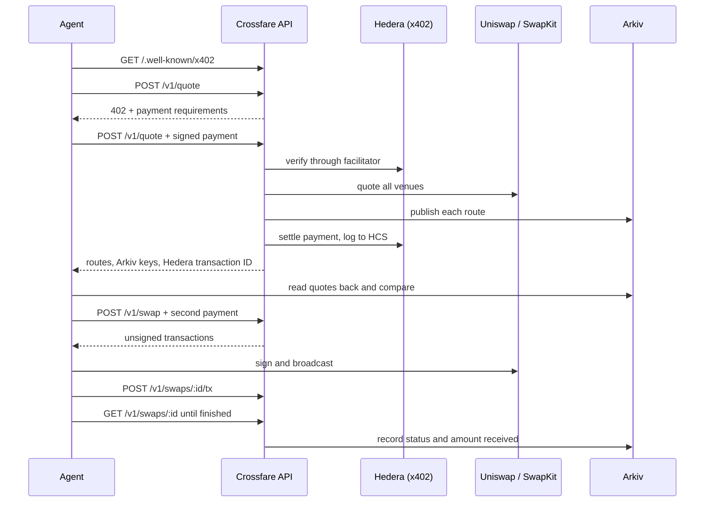

# Crossfare

An open-source cross-chain swap API that AI agents pay for per call. An agent needs only a wallet: it pays with x402 on Hedera, gets quotes it can check on Arkiv, and executes through the SwapKit API or Uniswap. Crossfare never holds the swapped funds.

Built at ETHGlobal Mumbai, Classic track.

> **Status:** in active development. The API and reference agent are covered by tests against mocked services. They have not yet completed a live run, so this README has no transaction links yet.

## How it works



### Payment flow

1. A paid endpoint called without payment answers `402` with USDC on `hedera:testnet`, the `payTo` account and the facilitator's fee payer.
2. The caller signs a Hedera transfer and retries with it in the `PAYMENT-SIGNATURE` header.
3. Crossfare claims the payment, so a replay fails, then verifies it through the facilitator before any upstream call.
4. It settles only when the request succeeds. A `409`, `422` or `502` costs the caller nothing.
5. The response carries the Hedera transaction ID, and the payment is logged to a public HCS topic.

## API

| Endpoint | Price | Purpose |
| --- | --- | --- |
| `GET /.well-known/x402` | Free | Endpoints, prices, payment details, Arkiv writer |
| `GET /v1/assets` | Free | Supported assets per venue |
| `POST /v1/quote` | 0.01 USDC | Ranked routes from every venue that supports the pair |
| `POST /v1/swap` | 0.05 USDC | Prepare one quote for execution |
| `POST /v1/swaps/:id/tx` | Free | Report the broadcast transaction hash |
| `GET /v1/swaps/:id` | Free | Swap status |
| `GET /v1/quotes?payer=` | Free | A payer's quotes, read from Arkiv |

Prices are placeholders, settled in testnet USDC. Payments and Arkiv use testnets. Swaps run on mainnet because Uniswap and SwapKit need real liquidity.

## Repository

| Path | Contents |
| --- | --- |
| `packages/core` | Asset registry, route ranking, venue adapters |
| `apps/api` | Hono service, payment guard, x402 gateway, Arkiv publisher, HCS audit log |
| `apps/agent` | Reference agent and spending controls |
| `scripts` | Setup and read-only checks |
| `arkiv/` | Arkiv prize documents |

**Where the Uniswap API is called:** [`packages/core/src/venues/uniswap.ts`](packages/core/src/venues/uniswap.ts), through `/quote`, `/check_approval` and `/swap`.

## Setup

Requires Node.js 22.18 or newer and pnpm.

```sh
pnpm install
cp .env.example .env   # then fill it in
pnpm test
pnpm setup:topic       # creates the audit topic; copy the ID into .env
pnpm check:venues      # read-only: real quotes, spends nothing
pnpm --filter @crossfare/api start
```

Run the agent in a second terminal. It stops before spending swap funds unless `AGENT_ALLOW_LIVE_SWAPS=true` is set:

```sh
pnpm --filter @crossfare/agent start --from base:usdc --to base:eth --amount 1
```

You need:

- Uniswap and SwapKit API keys
- two Hedera testnet accounts, both associated with testnet USDC (`0.0.429274`), and the agent's funded with USDC
- an Arkiv access key and a wallet funded from the faucet
- for live swaps, an EVM wallet on Base with a small balance

## Built with

Open-source libraries, used as published: [Hono](https://hono.dev), [`@x402/core`, `@x402/hedera`, `@x402/fetch`](https://github.com/x402-foundation/x402), [`@hiero-ledger/sdk`](https://github.com/hiero-ledger/hiero-sdk-js), [`@arkiv-network/sdk`](https://hub.arkiv.network), [viem](https://viem.sh) and [Vitest](https://vitest.dev). No starter kit was used. All project code was written during the hackathon.

## AI use

AI wrote most of this code under the developer's direction. [`AI_USAGE.md`](AI_USAGE.md) says where and how, and [`docs/prompts.md`](docs/prompts.md) records the prompts.

## License

[MIT](LICENSE)
