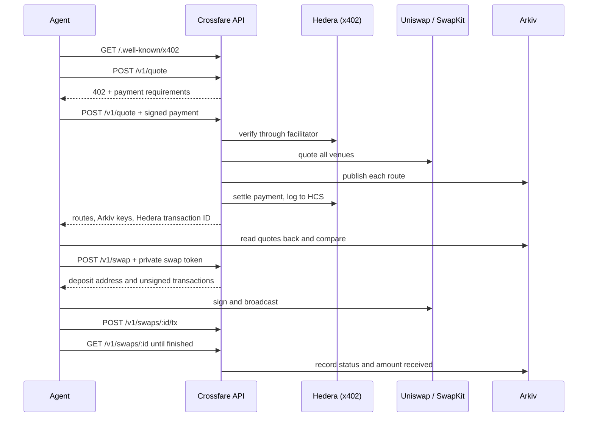

# Crossfare

An open-source cross-chain swap API that AI agents pay for per call. An agent pays for its quotes with x402 on Hedera, checks them on Arkiv, and executes through the SwapKit API, or Uniswap for same-chain swaps. It needs no signup or API key, and Crossfare never holds the swapped funds.

For example: you tell your agent to swap 5 USDC on Ethereum to ETH on Base. It asks for the receiving address, pays 0.01 testnet USDC on Hedera for a quote, publishes it on Arkiv, and sends the deposit that SwapKit routes.

Built at ETHGlobal Mumbai, Classic track.

> **Status:** the full loop has run live once on localhost: a real swap of 2 USDC on Ethereum delivered 1.997376 USDC on Base. See the [full test report](docs/live-test-2026-11-06.md). It isn't deployed yet, so there's no public URL.

## Live evidence

- **Settled x402 payment on Hedera:** [`0.0.9185802@1793955744.682983872`](https://hashscan.io/testnet/transaction/0.0.9185802@1793955744.682983872)
- **Audit log:** [HCS topic `0.0.11336749`](https://hashscan.io/testnet/topic/0.0.11336749)
- **Quote on Arkiv, quoted against received:** [`0x268005…54c5`](https://rabdi.explorer.arkiv.network/entity/0x26800551ca60a7f504a84f0e02cd068b62c98b4eb597a69262f5138a399c54c5), kept until about 13 November 2026
- **Deposit on Ethereum:** [`0xe42c95…c2ea`](https://etherscan.io/tx/0xe42c9597f79765a406baab374fae2c1e35d2813d1b7a2881ad301fbdc404c2ea)
- **Delivery on Base:** [`0x3dcbb7…a6bc`](https://basescan.org/tx/0x3dcbb74c8b5e5724063049977e195f71a85d826ef3c8346657c5d7aec8f7a6bc)

**Arkiv writer wallet:** `0xCA3994F906e54FB8707f529a506EEE755b636B52`. To list Crossfare's quotes with `@arkiv-network/sdk`:

```ts
const client = createPublicClient({ chain: rabdi({ accessKey }), transport: http() });
const page = await client
  .select({ $key: true, quoteId: true, venue: true, status: true, amountReceived: true, createdAt: true })
  .where(eq("project", "crossfare"))
  .ownedBy("0xCA3994F906e54FB8707f529a506EEE755b636B52")
  .orderBy(desc("createdAt"))
  .limit(50)
  .fetch();
```

## How it works



### Payment flow

1. A paid endpoint called without payment answers `402` with USDC on `hedera:testnet`, the `payTo` account and the facilitator's fee payer.
2. The caller signs a Hedera transfer and retries with it in the `PAYMENT-SIGNATURE` header.
3. Crossfare claims the payment, so a replay fails, then verifies it through the facilitator before any upstream call.
4. It settles only when the request succeeds. A `409`, `422` or `502` costs the caller nothing.
5. The response carries the Hedera transaction ID, and the payment is logged to a public HCS topic.

## API

| Endpoint | Price | Purpose |
| --- | --- | --- |
| `GET /.well-known/x402` | Free | Endpoints, prices, payment details, Arkiv writer |
| `GET /v1/assets` | Free | Supported assets per venue |
| `POST /v1/quote` | 0.01 USDC | Ranked routes from every venue that supports the pair |
| `POST /v1/swap` | Free for now | Prepare one quote for execution. Needs the `swapToken` from its quote response |
| `POST /v1/swaps/:id/tx` | Free | Report the broadcast transaction hash |
| `GET /v1/price?from=&to=&amount=` | Free | An indicative price for the UI while someone types. It isn't published, can't be executed and shares a rate limit between callers. |
| `GET /v1/swaps/:id` | Free | Swap status. It reads the deposit address on chain as well as asking the provider, so a deposit shows within seconds. |
| `GET /v1/quotes` | Free | Recent quotes, or one payer's with `?payer=`, read from Arkiv |
| `POST /demo/quote`, `POST /demo/swap` | Free, capped | The same calls, with any fee paid by a testnet account so visitors to the UI need no Hedera wallet |

Prices are placeholders, settled in testnet USDC. Set `SWAP_PRICE_USDC` to charge for `POST /v1/swap` as well. Quote IDs are public on Arkiv, so the swap call requires a private token that only the quote's caller receives. Payments and Arkiv use testnets. Swaps run on mainnet because Uniswap and SwapKit need real liquidity. Sender and receiving addresses are checked for their chain, screened through SwapKit when a swap is requested, and never published on Arkiv. Without the sending wallet connected, quotes use SwapKit's flexible deposit mode and skip its balance check, so the deposit can come from any wallet or exchange. The address given is then only where refunds go.

## Repository

| Path | Contents |
| --- | --- |
| `packages/core` | Asset registry, route ranking, venue adapters |
| `apps/api` | Hono service, payment guard, x402 gateway, Arkiv publisher, HCS audit log |
| `apps/agent` | Reference agent and spending controls |
| `apps/web` | Swap form, order page and public quote record |
| `scripts` | Setup and read-only checks |
| `deploy` | Service and HTTPS configuration for EC2 |
| `arkiv/` | Arkiv prize documents |

**Where the Uniswap API is called:** [`packages/core/src/venues/uniswap.ts`](packages/core/src/venues/uniswap.ts): `/quote` at [line 156](packages/core/src/venues/uniswap.ts#L156), `/check_approval` at [line 202](packages/core/src/venues/uniswap.ts#L202) and `/swap` at [line 212](packages/core/src/venues/uniswap.ts#L212).

## Setup

Requires Node.js 22.18 or newer and pnpm.

```sh
pnpm install
cp .env.example .env   # then fill it in
pnpm test
pnpm setup:topic       # creates the audit topic; copy the ID into .env
pnpm setup:usdc        # associates testnet USDC with the fee and agent accounts
pnpm check:venues      # read-only: real quotes, spends nothing
pnpm --filter @crossfare/api start
```

Run the agent in a second terminal. It asks for the receiving address unless you pass `--recipient`, and it stops before spending swap funds unless `AGENT_ALLOW_LIVE_SWAPS=true` is set:

```sh
pnpm --filter @crossfare/agent start --from eth:usdc --to base:eth --amount 5
```

You need:

- Uniswap and SwapKit API keys
- two Hedera testnet accounts, both associated with testnet USDC (`0.0.429274`) by `pnpm setup:usdc`, and the agent's funded with USDC
- an Arkiv access key and a wallet funded from the faucet
- for live swaps, a dedicated EVM wallet with small balances, including ETH for gas on the source chain

With `AGENT_HEDERA_ACCOUNT` set, the UI at `http://localhost:8787` works once the web app is built with `pnpm --filter @crossfare/web build`.

To work on the UI without any keys, run a fake API that spends nothing, then the dev server:

```sh
node apps/api/src/dev-mock.ts
pnpm --filter @crossfare/web dev
```

## Deploy

One EC2 instance serves the UI and API from a single URL. See [`docs/deploy-ec2.md`](docs/deploy-ec2.md).

## Built with

Open-source libraries, used as published: [Hono](https://hono.dev), [`@x402/core`, `@x402/hedera`, `@x402/fetch`](https://github.com/x402-foundation/x402), [`@hiero-ledger/sdk`](https://github.com/hiero-ledger/hiero-sdk-js), [`@arkiv-network/sdk`](https://hub.arkiv.network), [viem](https://viem.sh), [React](https://react.dev), [Vite](https://vite.dev), [wagmi](https://wagmi.sh), [qrcode.react](https://github.com/zpao/qrcode.react) and [Vitest](https://vitest.dev). No starter kit was used. All project code was written during the hackathon.

## AI use

AI wrote most of this code under the developer's direction. [`AI_USAGE.md`](AI_USAGE.md) says where and how, and [`docs/prompts.md`](docs/prompts.md) records the prompts.

## License

[MIT](LICENSE)
