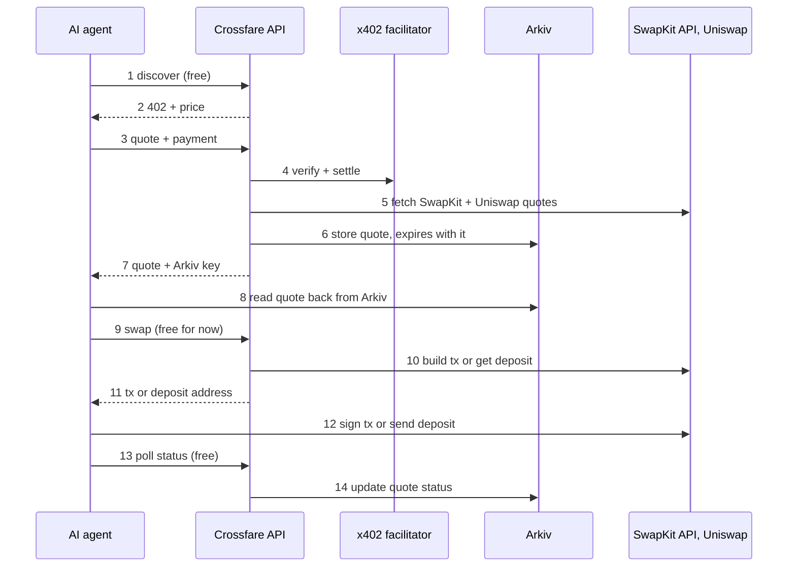
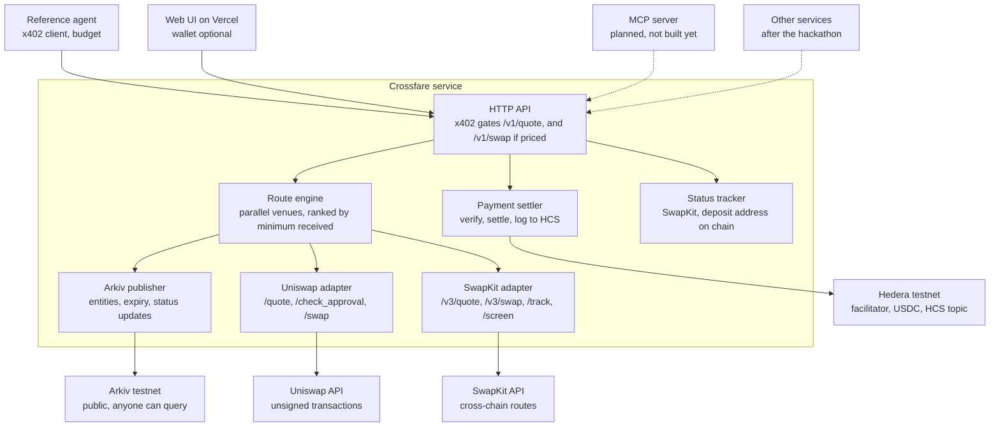
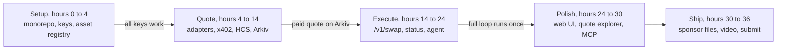

# Crossfare PRD

> **About this copy.** This is the public copy of Crossfare's requirements document, taken on 7 November 2026, because ETHGlobal asks that planning documents be in the submission repo. The working document is private, and this copy can fall behind it.
>
> **Removed:**
>
> - **SwapKit terms analysis:** a reading of SwapKit's Terms of Service, the risk row and open question that came from it, and the link to the terms.
> - **CoinDrop plans:** the section on integrating with CoinDrop, the developer's own product, including its roadmap and revenue notes, and other passages about that plan. Some sentences were reworded so the text still reads.
>
> **Changed:** the working document's diagrams can't be exported, so three are redrawn here in Mermaid, and the UI mock-up is replaced with a link to the live site. Nothing else was changed.

Aditya Paul

## Overview

Crossfare is an open-source cross-chain swap API that AI agents pay for per call: an agent finds it, pays with x402 on Hedera, gets a quote that lives on Arkiv until it expires, and executes through the SwapKit API or Uniswap.

**Problem.** Agents can plan a trade but struggle to execute one across chains. Swap providers need signups and API keys, quotes are short-lived and unverifiable, and nothing lets an agent pay per request without a human in the loop.

**Solution.** One HTTP API that:

- charges per quote over x402, with execution free for now, so any agent with a funded wallet can use it with no account
- routes each pair to the best venue: the SwapKit API for cross-chain and non-EVM swaps (THORChain, Chainflip, NEAR Intents and more), Uniswap for same-chain EVM swaps
- publishes every quote as a public Arkiv entity that expires with the quote, so anyone can verify what was quoted and when
- executes the chosen route and reports status until the funds land

**Demo story (ETHGlobal Mumbai).** An owner tells their agent to swap 20 USDC on Ethereum into ETH on Base and gives a receiving address. The agent discovers Crossfare, pays for quotes, reads them back from Arkiv, picks the best, executes it and confirms delivery, with no human approving anything after the instruction. A web UI lets a person do the same swap from a form.

**Later.** The same service can become the swap engine behind other products, which call Crossfare as an external service.

## How a swap runs

An owner tells their agent to swap 20 USDC on Ethereum into ETH on Base. The agent asks where to send it, pays for the quote on Hedera, and SwapKit does the routing and the swap.

1. **Instruct.** The owner's wallet holds 100 USDC on Ethereum. They tell the agent to swap 20 of it to ETH on Base.
2. **Ask.** The agent asks for the receiving address if the instruction didn't give one. It can be any valid Base address, not only the sender's.
3. **Pay and quote.** The agent calls POST /v1/quote and pays over x402 in testnet USDC on Hedera.
4. **Route.** SwapKit provides the whole route across its providers. Uniswap plays no part in a cross-chain swap.
5. **Publish.** The quote goes on Arkiv as a public record, with no wallet addresses in it. The agent reads it back and checks it.
6. **Execute.** POST /v1/swap returns a deposit address and the matching transaction. The agent signs the USDC transfer from the wallet.
7. **Confirm.** The agent polls until the ETH reaches the receiving address, and the Arkiv record gains the amount received.

### Four addresses, four jobs

A receiving address chosen per swap doesn't replace HEDERA\_PAY\_TO\_ACCOUNT, because that account collects Crossfare's API fee and never touches the swapped funds.

| Address | Set by | Network | Job |
| --- | --- | --- | --- |
| Sending wallet | Caller | Source chain (Ethereum here) | Holds the 20 USDC and signs the transfer |
| Refund address | Caller | Source chain | Gets the funds back if the swap fails; defaults to the sending wallet |
| Receiving address | Caller, on each swap | Destination chain (Base here) | Gets the ETH |
| HEDERA\_PAY\_TO\_ACCOUNT | Crossfare operator, once | Hedera testnet | Collects the x402 fee that the agent's Hedera account pays |

### Live check on 6 Nov 2026

This exact flow quotes today, but SwapKit's routes change from call to call. Nothing was signed or sent in these checks.

| Request | Result |
| --- | --- |
| 20 USDC on Ethereum to ETH on Base, different receiver, 3% slippage | Early calls: Flashnet only, about 0.00865 ETH, about 45 seconds, with NEAR short of liquidity. Later calls: NEAR about 0.00893 ETH and Flashnet about 0.00866 |
| /v3/swap for that route | A plain USDC transfer to a deposit address with no approval step. The deposit channel lasts 24 hours. Gas was about 0.0000125 ETH |
| Same swap sent to a burn address | SwapKit refused it with invalid\_recipient\_address |
| 5 USDC to ETH on Base | Uniswap about 0.002225 ETH, SwapKit through 1inch about 0.002222, SwapKit through Flashnet about 0.002212 |
| 0.01 ETH on Base to BTC | Flashnet only, not THORChain: 27,486 sats, about 632 seconds |

Further checks and SwapKit's [docs](https://docs.swapkit.dev/get-started/quote-and-swap-implementation-flow) add four limits:

- **Minimum.** 1 USDC was too small for Flashnet, and 2 USDC quoted through NEAR.
- **Sender balance.** /v3/swap returned insufficientBalance for a sender with no USDC, even with disableBuildTx. Crossfare now sets disableBalanceCheck when the deposit may come from another sender, although the docs say not to use it without consulting SwapKit. Raise this with them after the hackathon. The docs also don't say whether another sender may fund a channel, and no such deposit has been tested.
- **Rate limit.** A new key gets 10 requests a minute per service, so Crossfare asks for status at most every 10 seconds per swap, and reads the deposit address on chain in between.
- **Size limit.** A key is capped at $1,000 a trade by default, which the demo won't reach.

The same calls settled one assumption: SwapKit takes sellAmount in whole units, so "20" means 20 USDC.

### Build status

Live at crossfare.vercel.app, with the UI on Vercel and the API on EC2. Five real swaps have completed. Two ran from a local server: 2 USDC on Ethereum delivered 1.997376 USDC on Base through the agent, and 5 USDC on Ethereum delivered 0.0022257 ETH on Base through the UI with no wallet connected. Three ran on the deployed site on 7 November, all through SwapKit and NEAR, including 10 USDC on Ethereum to 0.0044597 ETH on Base, shown in the demo video. A real Uniswap swap, the UI with a real wallet and a deposit from an exchange are also untested.

- [x] The agent asks for the receiving address instead of defaulting to its own (FR-38)
- [x] The agent and the UI sign on Ethereum, not only on Base (FR-39)
- [x] The API returns deposit details for EVM simple-transfer routes (FR-22)
- [x] The web form and order page below (FR-40, FR-41)

* [x] Hedera keys starting 0x parse as ECDSA, which the SDK's default got wrong
* [x] A free /v1/swap with a private swap token and a configurable price (FR-42, FR-43)
* [x] A provider change between quote and swap returns a 409 with a fresh quote, not a 502
* [x] Status tracks deposit-only swaps by channel ID, and polling respects SwapKit's rate limit
* [x] A script associates USDC on both Hedera accounts
* [x] A real 5 USDC swap with no wallet connected: Ethereum USDC to ETH on Base, delivered
* [x] Live price, dollar values on quotes, stage tracker, result screen, wallet dialog and readable history (FR-44 to FR-48). The stage tracker has run during real swaps on the deployed site
* [x] Every SwapKit token in a searchable picker with logos, and deposits that differ from the quote reported rather than hidden (FR-49, FR-50). Real deposits of a different amount are untested
* [x] Deployed: the UI on Vercel, which forwards API requests to EC2 behind nginx, with HTTPS on a temporary sslip.io name
* [x] Real swaps on the deployed site, which were also the first real runs of the stage tracker and on-chain deposit check
* [x] Uniswap on all 21 of its chains, and any ERC-20 by contract with an unverified warning (FR-51, FR-52), built 9 November. Checked with real quotes on Arbitrum, Unichain and an unlisted Base token; no real swap on the new chains yet
* [x] NEAR Intents and THORChain called directly, with SwapKit as the fallback for both (FR-53 to FR-55), built 9 November. Checked with real quotes for LTC to SOL, SOL to LTC and LTC to BTC; no real swap through either directly yet. THORChain's Solana trading was halted, so it had no LTC to SOL route
* [x] Callers' own fees on swaps (FR-34 to FR-36), built 9 November; Crossfare takes none. Uniswap and the direct venues pay the caller's wallet, and SwapKit fees are recorded for payout. Checked with real quotes: Uniswap's fee appears as a separate output and its swap calldata names the fee wallet, and SwapKit honours `affiliateFee`, including 0. No real swap with a fee yet
* [ ] The MCP server (FR-2, P1), which isn't built, so packages/mcp doesn't exist

## How Crossfare is different

None of the options we found let an agent with only a wallet get a native cross-chain route, pay for it per call, and let anyone check afterwards what it was quoted. Each piece exists somewhere; Crossfare's claim is the combination, so the demo must show all of it in one run.

### The 30-second answer for judges

SwapKit already routes swaps across 30+ chains, but a person has to create its API key, so an autonomous agent can't start on its own. Pay-per-call swap APIs exist, but they stay on one chain or EVM bridges, and their quotes are private promises. Crossfare joins the two: no signup, native cross-chain routes through SwapKit plus Uniswap for same-chain swaps, payment on Hedera, and every quote published on Arkiv so the agent, its owner or anyone else can check it against what was delivered.

### Five edges and how the demo proves each

| Edge | Why it matters | Proof in the demo |
| --- | --- | --- |
| Zero to swap with only a wallet | Agents created on the fly can't each get a key from a dashboard | A funded agent wallet completes a swap with no signup or API key |
| Native cross-chain through SwapKit | Real BTC, XRP or SOL without wrapped tokens, via THORChain, Chainflip, NEAR Intents and more; Uniswap covers same-chain | USDC on Ethereum to ETH on Base, through SwapKit |
| Payment and audit on Hedera | The facilitator pays the network fee, so the agent holds only USDC; every payment lands on a public HCS topic, giving owners a spending log | HashScan link per paid call and the HCS log on screen |
| Quotes as public commitments on Arkiv | A quote stops being a private API response: it's timestamped, owned by Crossfare's wallet, expires on time, and sits next to the amount actually received. Over time this becomes a public quote-accuracy record per provider | Agent reads its quote back; the explorer shows quoted versus received |
| A business layer for other services | VIP keys and per-request integrator fees let wallets and agent platforms embed Crossfare and earn on it | Shown on the roadmap slide |

FR-18 records the amount actually received, so the explorer can show quoted versus received side by side.

### Compared with the alternatives

| Capability | [SwapKit API](https://www.swapkit.dev/agents/) | [Tollbooth](https://glama.ai/mcp/servers/bqebiavawh) | [PayToll](https://implexa.ai/s/clawhub/paytoll) | [FORGE](https://socket.dev/npm/package/@morebetterclaw/forge-swap) | Crossfare |
| --- | --- | --- | --- | --- | --- |
| Agent starts without a person creating a key | No | Yes | Yes | Not stated | Yes |
| Native cross-chain, including Bitcoin | Yes | No, same-chain swaps on 8 chains | EVM bridges | THORChain only | Yes, through SwapKit |
| Pay per call | No; free API plus 0.10–0.15% per swap | Yes, USDC on Base or Solana | Yes, on Base | No; fee per swap | Yes, USDC on Hedera |
| Quote record anyone can query | Swap tracking only | Signed receipts checked through its own API | Not stated | Not stated | Yes, on Arkiv |
| Caller sets its own fee | Yes, affiliate fee | Not stated | Not stated | Operator-set fee | Yes, per request |

### Follow-up questions to prepare

- **"Isn't this just a wrapper around SwapKit?"** On purpose. Routing is a commodity and SwapKit does it well; Crossfare builds what agents lack around it: access without keys, payment, verification and fees.
- **"Why wouldn't a developer just get a SwapKit key?"** For one app built by a person, they should. Crossfare is for agents created on the fly and owners who want every call paid and logged without managing keys.
- **"What if SwapKit adds x402 itself?"** Then Crossfare uses it. The Arkiv quote record, the Uniswap route and the VIP and fee layer still stand, and the plan is to partner with SwapKit, not race it.
- **"Why Arkiv and not Postgres?"** A quote in our own database is only as trustworthy as our server. On Arkiv anyone can query quotes without asking us, entries expire on schedule, and every change is a visible on-chain transaction rather than a silent edit.
- **"Why Hedera?"** The facilitator pays the network fee, USDC settles as a native token with fast finality, and HCS gives a tamper-evident spending log without writing a contract.
- **"Who will actually use it?"** Other products can integrate it after the hackathon, and the reference agent and MCP server let any agent developer try it in minutes.

## Goals and non-goals

The hackathon goal is one end-to-end paid swap by an unattended agent, built so the same core can later serve other products.

**Hackathon goals (ETHGlobal Mumbai, Classic track)**

1. An agent completes the full loop (discover, pay, quote, execute, confirm) with no human approval.
2. At least one real swap through Uniswap and one cross-chain swap through the SwapKit API, both shown in the demo.
3. Every quote readable from Arkiv by its entity key, and the agent reads it back before executing.
4. Each x402 payment settles on Hedera testnet, with its transaction linked on HashScan.
5. Qualify for Uniswap, Hedera and Arkiv partner prizes and for finalist judging.

**Post-hackathon goals**

- Add more venues (other DEX aggregators, bridges) behind the same route interface.
- Run Crossfare as a public paid API for third-party agents.

**Non-goals**

- No custody of user funds in Crossfare itself. Swapped funds move from the caller's wallet to the venue. The one exception is callers' fees earned through SwapKit, which SwapKit pays to the operator's wallets and Crossfare passes on (FR-35).
- No self-serve accounts or dashboards; VIP keys are issued by hand after the hackathon.
- No own liquidity, market making or price oracle.

## Users and use cases

AI agents are the primary user at the hackathon.

| User | What they need | How they use Crossfare |
| --- | --- | --- |
| Autonomous AI agent | Move value across chains within a budget, without signups | Pays per call over x402, compares quotes, executes, polls status |
| Agent developer | A swap tool their agent can call | Installs the MCP server or calls the REST API with an x402 client |
| Person on the demo UI | Swap from a simple form with no account | Uses the web UI, which calls the same API; enters a receiving address and a refund address and sends the deposit from any wallet or exchange, or connects a wallet to sign |
| Anyone auditing | Check what a swap was quoted at | Queries Arkiv by quote key, pair or payer address |

**Example jobs an agent can do with it**

- Rebalance a treasury from ETH on Base into USDC on another chain.
- Pay an invoice in a token it doesn't hold by swapping first.
- Pick the cheaper of two routes for the same pair and explain the choice.

## Core flow

One swap costs the agent one x402 payment, for its quotes. Execution is free for now, and Crossfare never touches the swapped funds.



1. **Discover.** The agent finds Crossfare through its MCP server or `GET /.well-known/x402` (free), which lists endpoints, prices and supported pairs.
2. **Price.** A paid endpoint called without payment returns `402 Payment Required` with the price, asset (USDC on Hedera testnet), `payTo` account and facilitator fee payer.
3. **Pay for quotes.** The agent's x402 client signs a Hedera transfer and retries `POST /v1/quote` with the payment header.
4. **Settle.** Crossfare has the facilitator verify the payment before doing any work and settles it once the response is ready, so a failed request costs nothing. The facilitator pays the Hedera network fee.
5. **Quote.** Crossfare asks the SwapKit API and Uniswap in parallel and ranks routes by amount received after fees.
6. **Publish.** Each route becomes an Arkiv entity that expires when the quote does.
7. **Return.** The agent gets quote IDs, Arkiv entity keys and the Hedera transaction ID of its payment.
8. **Verify.** The agent reads its chosen quote from Arkiv and checks it matches the API response.
9. **Execute.** The agent calls `POST /v1/swap` with the quote ID and the private swap token from its quote response. No payment is needed for now.
10. **Prepare.** For Uniswap, Crossfare builds the unsigned approval and swap transactions. For SwapKit routes, it gets the transaction to sign, or a deposit address, plus a memo where the route needs one. A non-EVM source such as Bitcoin always uses a deposit.
11. **Hand back.** The agent receives transactions to sign, or a deposit address, exact amount and deadline.
12. **Fund.** The agent signs and broadcasts, or sends funds to the deposit address.
13. **Track.** The agent polls `GET /v1/swaps/{id}` (free) until `completed`, `refunded` or `failed`.
14. **Record.** Crossfare updates the Arkiv entity with the final status and transaction hashes.

## Web UI

A person sees one form and one order page, following FixedFloat's flow in Crossfare's own glass look. No account or wallet connection is needed, and the deposit can come from any wallet or exchange. The amount is priced as it's typed, each quote shows dollar values, and the order page follows the swap stage by stage.

The [live UI](https://crossfare.vercel.app) shows this flow.

| FixedFloat | Crossfare | Why it differs |
| --- | --- | --- |
| Pair, amount and estimate on one form | Same |  |
| Receiving address on the form | Same, checked for the destination chain and screened |  |
| Nothing else to enter | Also a refund address | A provider needs somewhere to return funds, and an exchange deposit address can't be it. Connecting a wallet fills it in |
| Fixed or float rate | Expected and minimum amounts, no toggle | The SwapKit docs read so far show no locked rate, so Crossfare shouldn't promise one |
| Deposit address and exact amount | Same, plus copy and QR | Comes from SwapKit on simple-transfer routes |
| 10-minute lock on a fixed rate | A 30-minute order window, or SwapKit's deadline if sooner | SwapKit has no setting to shorten a provider's channel: about 72 hours on NEAR in a live check, and a flat 24 hours on Flashnet and Chainflip. The window limits what Crossfare shows and promises. A late deposit may still be processed after Crossfare shows the order as expired |
| Confirmations, then explorer links | Three live stages, a result screen with the amount received, plus HashScan, Arkiv and explorer links | Shows what each sponsor did |
| No wallet connection | Optional "Connect wallet" | Contract-call routes such as Uniswap and 1inch need a signature. The UI signs on every chain Uniswap trades on (FR-51), and elsewhere a route that needs a signature says so and can't be chosen |

A visitor has no Hedera account, so Crossfare's capped demo payer pays their x402 fee. That payment is real, but it doesn't show an agent paying for itself, so the demo also runs the terminal agent.

FixedFloat's page shows "This service is unavailable in India" from here, so we couldn't view it directly. Its column comes from two independent write-ups: [CriptoNoticias](https://www.criptonoticias.com/tutoriales-guias/fixedfloat-mejor-forma-cambiar-bitcoin-criptomonedas) (updated March 2024) and [Solana Compass](https://solanacompass.com/projects/fixedfloat). Check it against current screenshots before treating it as exact.

## Functional requirements

The demo has 37 requirements marked P0; P1 items earn sponsor extra points if time allows, and P2 waits for after the hackathon.

| ID | Area | Requirement | Priority |
| --- | --- | --- | --- |
| FR-1 | Discovery | Serve `GET /.well-known/x402` listing paid endpoints, prices, payment asset, network and supported chains | P0 demo |
| FR-2 | Discovery | MCP server with `get_quote`, `execute_swap` and `get_status` tools that pay via x402 | P1 if time |
| FR-3 | Discovery | Publish an OpenAPI spec and `llms.txt` | P1 if time |
| FR-4 | Payments | Paid endpoints answer `402` with x402 `exact` requirements on `hedera:testnet`, priced in USDC | P0 demo |
| FR-5 | Payments | Verify payment before any upstream call, settle only when the request succeeds, and reject a reused payment | P0 demo |
| FR-6 | Payments | Return the Hedera transaction ID of each payment in the response | P0 demo |
| FR-7 | Payments | Log every settled payment to an HCS topic (payer, endpoint, amount, quote ID) | P0 demo |
| FR-8 | Compliance | Screen sender and recipient addresses with SwapKit `/screen` before swapping; a failed check blocks the swap and costs nothing | P0 demo |
| FR-9 | Quoting | Accept from/to chain and token, amount, exact-in or exact-out, recipient, refund address, slippage | P0 demo |
| FR-10 | Quoting | Quote same-chain EVM pairs through the Uniswap Trading API `/quote` | P0 demo |
| FR-11 | Quoting | Quote all pairs through the SwapKit API `/v3/quote`, across its providers | P0 demo |
| FR-12 | Quoting | Normalize every result into one route shape and rank by minimum received after fees | P0 demo |
| FR-13 | Quoting | Asset registry mapping Crossfare asset IDs to Uniswap token addresses and SwapKit asset identifiers | P0 demo |
| FR-14 | Quoting | Two-leg routes: Uniswap into a SwapKit-supported asset, then SwapKit across chains | P2 later |
| FR-15 | Arkiv | Write each route as an Arkiv entity expiring at quote validity plus 120 seconds; write asynchronously and return the key with a pending flag until confirmed | P0 demo |
| FR-16 | Arkiv | Index quotes by project, type, quote ID, venue, assets, payer, status and timestamps | P0 demo |
| FR-17 | Arkiv | Agent and UI read quotes from Arkiv by entity key and by payer | P0 demo |
| FR-18 | Arkiv | Update status on execution, record the amount actually received, and extend completed records to 7 days | P0 demo |
| FR-19 | Arkiv | Write all routes for one request in a single batch transaction | P1 if time |
| FR-20 | Execution | `POST /v1/swap` rejects expired quotes; if price moved past slippage it returns `409` with a fresh quote (a new Arkiv entity under the same request ID) and charges nothing | P0 demo |
| FR-21 | Execution | Uniswap: call `/check_approval` and `/swap`, return unsigned approval and swap transactions | P0 demo |
| FR-22 | Execution | SwapKit: return the transaction to sign, and the deposit address, exact amount, memo and expiry for non-EVM sources and EVM simple-transfer routes | P0 demo |
| FR-23 | Execution | Webhook to integrators on every status change | P2 later |
| FR-24 | Execution | Track status from chain receipts and SwapKit `/track` into one state machine | P0 demo |
| FR-25 | Agent | Reference agent that discovers, pays, compares quotes, reads Arkiv, executes and polls with no human | P0 demo |
| FR-26 | Agent | Spending controls: per-call cap, total budget, allowed `payTo` accounts, graceful stop when low | P0 demo |
| FR-27 | Demo UI | Order page shows the deadline, Arkiv, HashScan and Basescan links, and a status timeline | P0 demo |
| FR-28 | Demo UI | Public quote explorer listing recent quotes read from Arkiv | P0 demo |
| FR-37 | Quoting | The caller gives a receiving address, separate from the sender, checked for the destination chain and never published to Arkiv | P0 demo |
| FR-38 | Agent | The agent asks its owner for the receiving address when the instruction has none, and never assumes its own | P0 demo |
| FR-39 | Execution | The agent and the UI sign on the route's source chain, Ethereum and Base at minimum | P0 demo |
| FR-40 | Demo UI | One-form swap screen: pair, amount, expected and minimum received, receiving address, refund address; no account or wallet connection needed | P0 demo |
| FR-41 | Demo UI | Order page: deposit address with copy and QR, exact amount and live status; a connected wallet can send it in one step | P0 demo |
| FR-42 | Execution | POST /v1/swap requires a private swap token returned by POST /v1/quote and never published, because quote IDs are public on Arkiv; fresh quotes per request are capped | P0 demo |
| FR-43 | Payments | SWAP\_PRICE\_USDC sets the swap price: unset means free, a value turns on x402 for that endpoint with no other change; discovery shows the current price | P0 demo |
| FR-44 | Web UI | Free GET /v1/price prices an amount as it's typed, after a 500 ms pause. It isn't published and has no ID to execute. Callers share a cache and a 7-second interval, falling back on the pair's last rate, flagged as estimated | P0 demo |
| FR-45 | Web UI | Every route shows dollars paid and received, unit price, swap cost, time and guaranteed minimum. A route without venue prices borrows them from a neighbouring route or a stablecoin side | P0 demo |
| FR-46 | Execution | Status reads the deposit address on chain every 4 seconds as well as asking the provider, takes progress from SwapKit's legs, and never moves backwards. The UI shows Send deposit, Swapping and Delivered | P0 demo |
| FR-47 | Arkiv | Records read as history: statuses are words such as Completed, with a one-line summary and no addresses. The History page lists them, with swaps and all quotes as separate views | P0 demo |
| FR-48 | Web UI | Connecting opens a dialog listing each wallet the browser announces (EIP-6963), and a token picker replaces native selects | P0 demo |
| FR-49 | Routing | The asset list is every token in SwapKit's public provider lists, refreshed daily, with logos, search by name, symbol or contract, and a chain filter. Any chain can be the source when the route is a plain transfer. Other routes need a signature, which the UI offered on Ethereum and Base only until FR-51 | P0 demo |
| FR-50 | Execution | A deposit that differs from the quote is reported, not hidden. On NEAR routes the order states the minimum (slippage below the quote when flexible). Below it the page says how much arrived, how much more is needed and when the refund is due, and doesn't expire while funds sit there. The result screen shows what was really sent and any refund | P0 demo |
| FR-51 | Routing | Uniswap quotes on every mainnet its Trading API supports (21 on 9 November), and the agent and UI sign on all of them. The catalog adds Uniswap's default token list and each chain's native coin to SwapKit's lists. Built 9 November | P2 later |
| FR-52 | Routing | Any ERC-20 on those chains can be named by contract, as `chain:0x…`. A token on no list is read from the chain, kept so swaps naming it resolve, quoted on Uniswap only (same chain) and flagged `unlisted_token`; the picker finds it by pasted address and marks it Unverified. Built 9 November | P2 later |
| FR-53 | Routing | Quote NEAR Intents directly through its 1Click API with an app fee, when a fee recipient is configured. A live quote, and so a deposit address, is made only when a swap is requested. 1Click keeps half of the app fee and at least 20 bps, so a full fee needs a partner agreement. Built 9 November | P2 later |
| FR-54 | Routing | Quote THORChain directly through a THORNode with an affiliate THORName, when one is configured. Deposits from UTXO chains carry the memo, so they need a wallet that can attach one; EVM sources get an approval and a router call to sign. Built 9 November | P2 later |
| FR-55 | Routing | SwapKit stays the fallback: its route through NEAR Intents or THORChain is dropped only when the direct venue returned a route for the same request. Built 9 November | P2 later |

## Architecture

Crossfare is one TypeScript service with three thin clients. Everything ships in a public MIT repo except API keys and the private order store.



The route engine is the only part that knows about venues. Adding a venue later (another DEX aggregator or a bridge) means one new adapter behind the same route interface.

**Deployment.** The UI runs on Vercel at crossfare.vercel.app and forwards `/v1` and `/demo` to the API, so the browser only talks to one address. The API runs on AWS EC2 behind nginx, with HTTPS on a temporary sslip.io name until a domain is chosen. The MCP server (FR-2, P1) isn't built yet.

### Tech stack

| Layer | Choice | Why |
| --- | --- | --- |
| Runtime | Node.js 22 + TypeScript | The Arkiv SDK needs Node 22+, and the Uniswap, x402 and Arkiv tooling is all TypeScript ([Arkiv TS guide](https://arkiv.dev.golem.network/getting-started/typescript)) |
| HTTP server | Hono | Small, typed, runs on Node and Bun |
| x402 | `@x402/hedera` exact scheme + a facilitator from the Hedera docs list | Client and server sides of Hedera x402 payments ([Hedera docs](https://docs.hedera.com/solutions/ai/x402/pay-with-x402.md)) |
| Hedera | `@hiero-ledger/sdk` | HCS audit topic, account and token association |
| Arkiv | `@arkiv-network/sdk` | Entities with attributes, queries and expiry ([Arkiv SDK](https://arkiv.dev.golem.network/docs/sdk)) |
| Uniswap | Trading API over HTTPS | `/check_approval`, `/quote`, `/swap` ([Uniswap docs](https://docs.uniswap.org/api/trading/overview)) |
| Swap routing | SwapKit API v3, x-api-key | `/v3/quote`, `/track` and `/screen` cover routing, status and address screening for 30+ chains ([SwapKit API docs](https://docs.swapkit.dev/api-reference/introduction)) |
| EVM | viem | Receipts, balances, signing in the reference agent |
| Storage | SQLite through node:sqlite | Payments, quotes and swap records; private |
| Web UI | React + Vite + wagmi | Swap form and order page; wallet connection is optional |
| Repo | pnpm monorepo | `packages/core`, `apps/api`, `apps/web`, `apps/agent`, `packages/mcp` |

### Private store (SQLite)

- **payments**: id, payer, endpoint, amount, Hedera transaction ID, settled at, used by (quote or swap ID). The unique transaction ID blocks replays.
- **quotes**: id, request ID, normalized route JSON, Arkiv entity key, valid until.
- **swaps**: id, quote ID, venue, SwapKit provider and swap ID, transaction hashes, status, timestamps.

The SwapKit API key lives only in the server environment. It is never returned to callers or written anywhere public.

### Arkiv quote entity

One entity per route, owned by the Crossfare service wallet so only Crossfare can change it. The payload is the normalized route JSON; it expires at the quote's validity plus 120 seconds, and completed swaps are extended to 7 days.

| Attribute | Type | Example | Used for |
| --- | --- | --- | --- |
| project | string | crossfare | Scope every query to Crossfare data |
| type | string | quote | Separate quotes from other entity types |
| quoteId | string | q\_7f3a… | Lookup from the API response |
| requestId | string | r\_19c2… | Group competing routes from one request |
| venue | string | uniswap | Filter and compare venues |
| fromAsset | string | base:usdc | Pair queries |
| toAsset | string | sol:sol | Pair queries |
| payer | string | 0.0.51234 | "My quotes" in the agent and UI |
| status | string | Quoted | Quoted, In progress, Completed, Refunded, Failed, Expired |
| createdAt | number | 1762339200 | Recent-quotes explorer |
| validUntil | number | 1762339290 | Show live quotes only |
| summary | string | Swapped 5 USDC on Ethereum for 0.0022 ETH on Base | A readable line, so a record reads as history; not indexed |

Never written to Arkiv: API keys, sender, receiving or refund addresses, or anything that identifies a person beyond the paying account.

## API specification

Eight endpoints; only quoting is paid for now, and prices are placeholders settled in testnet USDC during the hackathon. Two more routes, /demo/quote and /demo/swap, let the web UI pay for visitors within per-visitor and daily limits.

| Endpoint | Price | Purpose |
| --- | --- | --- |
| `GET /.well-known/x402` | Free | Discovery: endpoints, prices, payment network and asset, `payTo` account |
| `GET /v1/assets` | Free | Every token SwapKit lists, with logos and chains, refreshed daily |
| `POST /v1/quote` | 0.01 USDC | Routes from every venue that supports the pair |
| `POST /v1/swap` | Free for now | Execute one quote |
| `GET /v1/swaps/{id}` | Free | Swap status |
| `GET /v1/quotes?payer=` | Free | Read of recent quotes from Arkiv, or one payer's with ?payer= |
| GET /v1/price?from=&to=&amount= | Free | An indicative price while someone types; not published and can't be executed |
| POST /v1/swaps/{id}/tx | Free | Report a broadcast transaction hash |

Asset IDs are `chain:symbol` (`eth:usdc`, `base:eth`, `sol:sol`, `xrp:xrp`). The registry maps each one to a Uniswap token address and a SwapKit asset identifier.

Tokens from SwapKit's lists use `chain:symbol-contract`, because tickers repeat on a chain, for example `arb:1inch-0x6314…`. They load at startup and refresh daily, with the built-in assets always available.

### POST /v1/quote

Request:

```json
{
  "from": { "asset": "eth:eth", "amount": "0.01", "address": "0xAgent…" },
  "to": { "asset": "eth:usdc", "address": "0xAgent…" },
  "mode": "exact_in",
  "slippageBps": 50,
  "refundAddress": "0xAgent…"
}
```

Response:

```json
{
  "requestId": "r_19c2",
  "payment": { "network": "hedera:testnet", "transactionId": "0.0.51234@1762339200.123" },
  "routes": [
    {
      "quoteId": "q_7f3a",
      "venue": "uniswap",
      "amountOut": "31.92",
      "minAmountOut": "31.76",
      "fees": { "network": "0.00021 ETH" },
      "etaSeconds": 30,
      "validUntil": "2026-11-07T10:01:30Z",
      "arkiv": { "entityKey": "0x…" }
    },
    {
      "quoteId": "q_8b11",
      "venue": "swapkit",
      "provider": "chainflip",
      "amountOut": "31.71",
      "minAmountOut": "31.55",
      "fees": { "network": "0.00030 ETH", "swapkit": "0.15%" },
      "etaSeconds": 120,
      "validUntil": "2026-11-07T10:01:30Z",
      "arkiv": { "entityKey": "0x…" }
    }
  ]
}
```

Numbers and pairs here are illustrative; the demo pairs are under Demo configuration. Routes are sorted by `minAmountOut`, highest first.

### POST /v1/swap

Request: `{ "quoteId": "q_7f3a", "swapToken": "…" }`. Crossfare rejects an expired quote and re-quotes when the price moved past `slippageBps`.

Uniswap response: unsigned transactions for the caller to sign, in order.

```json
{
  "swapId": "s_42d0",
  "venue": "uniswap",
  "transactions": [
    { "kind": "approval", "chainId": 1, "to": "0x…", "data": "0x…", "value": "0x0" },
    { "kind": "swap", "chainId": 1, "to": "0x…", "data": "0x…", "value": "0x0" }
  ]
}
```

SwapKit response: the same `transactions` shape for EVM sources, or a deposit address and memo when the source is a chain like Bitcoin.

```json
{
  "swapId": "s_42d1",
  "venue": "swapkit",
  "provider": "thorchain",
  "deposit": { "asset": "btc:btc", "address": "bc1q…", "memo": "=:ETH.ETH:0xAgent…", "amount": "0.001", "expiresAt": "2026-11-07T10:10:00Z" }
}
```

### GET /v1/swaps/{id}

Returns `status` (`awaiting_deposit`, `confirming`, `exchanging`, `completed`, `refunded`, `failed`, `expired`), transaction hashes per leg and the Arkiv entity key.

It also returns `amountReceived`, `amountSent` (what was really deposited), `depositShort` (what has arrived while it's below the minimum), `minAmount`, `refundBy`, `refundReason` and `partialRefund`.

### Errors

| Code | When |
| --- | --- |
| 402 | Missing, invalid or reused payment |
| 409 | Quote expired or price moved past slippage; the body carries a fresh quote and nothing is charged |
| 422 | Pair or amount not supported by any venue |
| 502 | A venue failed; the payment isn't settled, so the agent isn't charged |

## VIP mode and integrator fees

Two provisions follow the hackathon build: VIP callers skip the per-call x402 payment, and any caller can add its own fee to the swaps it routes through Crossfare.

### VIP mode

VIP callers authenticate with a key instead of paying per call; x402 stays the default for everyone else. FR-29 to FR-32 were built on 8 November; [docs/vip.md](vip.md) is the integrator guide. FR-33 isn't built.

- **Order of checks.** The middleware looks for a VIP credential first. A valid one skips x402; anything else gets the normal `402`.
- **Credential.** `Authorization: Bearer cf_live_…` plus an `X-Crossfare-Sign` header: HMAC-SHA256 over the timestamp, method, path and raw body, with the timestamp sent in X-Crossfare-Timestamp, accepted within 60 seconds. The HMAC secret is the SHA-256 of the key, which is all the server stores, so a copy of the database can't pass the Bearer check. A leaked key alone can't replay old requests. A bad credential gets the normal 402 with the reason; a missing scope gets 403, and a rate limit or quota 429.
- **Controls.** Keys are stored hashed, with scopes (quote, swap), per-key rate limits, a monthly quota and instant revocation.
- **Billing.** Usage is metered per key and settled off-chain, by invoice or prepaid balance.
- **Agent self-upgrade.** `POST /v1/vip/pass` is itself paid once over x402 and returns a short-lived token for a set number of calls or 24 hours. An autonomous agent gets VIP pricing without a human issuing a key.
- **On Arkiv.** The `payer` attribute holds the key's label, such as `vip:partner`, never the key.

### Integrator fees

Decided on 9 November: Crossfare takes no fee on swaps; it is routing infrastructure. The caller sets its own fee and wallets on each quote request, and earns it on every swap it routes. Crossfare shows it in every route and builds it into execution. Built 9 November; [docs/fees.md](fees.md) is the caller's guide.

```json
"fee": {
  "bps": 100,
  "recipients": { "evm": "0xServiceTreasury…", "near": "service.near", "thorchain": "sv" }
}
```

| Venue | How the fee is taken | Custody |
| --- | --- | --- |
| Uniswap | Uniswap's `integratorFees` (bips + the caller's `evm` wallet), taken from the output inside the swap calldata. Any key can pass it; up to 500 bips an entry (measured 9 November) | Non-custodial, one atomic transaction |
| NEAR Intents, direct | 1Click's `appFees` to the caller's `near` account, or its `evm` address, which is also an Intents account. 1Click passes on half and keeps at least 20 bps | Non-custodial |
| THORChain, direct | The memo's affiliate, the caller's `thorchain` THORName | Non-custodial |
| SwapKit | SwapKit's `affiliateFee`, sent on every quote (0 without a fee, so the dashboard's tiers never apply). SwapKit pays only the wallets in the operator's dashboard, never one named in the request, so Crossfare records each caller's fee on a completed swap and pays it out later | The swap is non-custodial; the fee passes through the operator |
| `mode: "ledger"` | Crossfare only computes the fee; the caller takes it in its own books. Not built | Caller's ledger |

- **Cap.** 500 bps, the lower of Uniswap's and 1Click's limits; above it the request is refused.
- **Recipients by venue.** A venue with no matching recipient charges no fee, and the route says so by showing none.
- **Disclosure.** Each route shows the caller's share as `fees.integrator` (SwapKit's as `fees.affiliate`), and the route goes into the Arkiv quote payload. The caller's wallets are not published.
- **Payouts.** SwapKit fees are recorded per payer, asset and recipients; `vip-cli.ts earnings` totals a month. Paying them out isn't automated.

| ID | Area | Requirement | Priority |
| --- | --- | --- | --- |
| FR-29 | VIP | Check for a VIP credential before x402; a valid key skips payment. Built 8 November | P2 later |
| FR-30 | VIP | Hashed keys with scopes, rate limits, monthly quota and revocation. Built 8 November | P2 later |
| FR-31 | VIP | Signed requests: HMAC over timestamp and body, 60-second window. Built 8 November | P2 later |
| FR-32 | VIP | Per-key usage metering with export for billing. Built 8 November | P2 later |
| FR-33 | VIP | x402-paid pass that returns a short-lived VIP token | P2 later |
| FR-34 | Fees | `fee` on quote requests, checked against the cap, with a recipient per kind of venue. Built 9 November | P2 later |
| FR-35 | Fees | Uniswap via `integratorFees`, NEAR Intents and THORChain directly, SwapKit via `affiliateFee` with a ledger of what each caller is owed. Payouts and ledger mode aren't built. Built 9 November | P2 later |
| FR-36 | Fees | Fee shown per route and recorded in the Arkiv payload. Built 9 November | P2 later |
| FR-56 | Fees | Replaced on 9 November, the day it was built: Crossfare's own fee on Uniswap swaps, set by the operator per VIP key. Crossfare takes no fee; callers set theirs (FR-34) | Dropped |

## Sponsor tracks

Crossfare enters the Classic track for finalist judging plus three partner prizes: Uniswap, Hedera and Arkiv ([prize page](https://ethglobal.com/events/mumbai/prizes)). Each partner counts once even when its several tracks apply.

| Partner | Track | Pool | What it judges |
| --- | --- | --- | --- |
| Uniswap Foundation | Build with Uniswap | $10,000 (1st $4,000) | Any integration of the Uniswap stack, including the API |
| Hedera | AI Agents That Pay: x402 on Hedera | $6,500 (1st $3,000) | Paid endpoint settled on Hedera, agent pays with no human |
| Hedera | No Solidity Allowed | $2,000 (2 × $1,000) | Hedera SDKs only, at least two native services |
| Arkiv | Build on Arkiv (from scratch) | $4,000 (1st $3,000) | Feedback, reach, why Arkiv, how you use Arkiv (25% each) |
| Arkiv | Arkiv + Swarm bonus | $500 | Optional; only if time allows |

### Uniswap checklist

- [x] Public open-source repo with `FEEDBACK.md`
- [ ] Feedback form submitted with the link to `FEEDBACK.md`
- [x] README points to the exact files and lines that call the Uniswap API
- [ ] Demo shows a real Uniswap swap on chain. This is our choice: the track requires the repo, FEEDBACK.md and the form, not a swap

### Hedera checklist

- [x] At least one x402-protected endpoint settling on Hedera testnet through a listed facilitator or our own
- [x] An agent finds the endpoint and completes a paid request end to end, with no human approving
- [x] README covers setup, architecture and the payment flow, with the Hedera transaction ID of a settled payment
- [x] Demo video of 5 minutes or less showing a payment settling, linked on HashScan
- [x] Extra points: spending limits (FR-26), HCS audit log (FR-7), settling in USDC (HTS)
- [x] For No Solidity: no Solidity anywhere, HTS + HCS used through the SDK

### Arkiv checklist

- [x] Writes to Arkiv's current testnet with `@arkiv-network/sdk`, and a user-visible feature reads from Arkiv (FR-17)
- [x] README lists the wallet address that wrote entities and one query judges can run
- [x] `/arkiv/schema.md`: entities, queried fields, owner, expiry
- [x] `/arkiv/friction.md`: what got in the way, with reproduction steps
- [x] `/arkiv/reach.md`, `/arkiv/why-arkiv.md`, `/arkiv/how-you-use-arkiv.md`, each answering its judging questions
- [x] Open-source license and a note on how AI was used

### ETHGlobal rules

- [ ] All project code written after the hackathon starts; public libraries and starter kits are fine ([rules](https://ethglobal.com/events/mumbai/info/details))
- [ ] Up to 3 partner prizes selected on the submission form
- [x] Steady commit history, not one upload at the end

* [ ] No pre-written code, UI designs or assets in the repo; planning docs such as this PRD are fine
* [ ] AI help is allowed, but submissions that rely entirely on AI may lose prize eligibility, so the commit history and README show what you built ([rules](https://ethglobal.com/events/mumbai/info/details))

## Security, risks and constraints

The biggest risk is the demo depending on real-money mainnet swaps through SwapKit and Uniswap; both are kept tiny and rehearsed before judging.

**Security principles**

- Crossfare is non-custodial in the public build. Swapped funds go from the agent's wallet to the venue, never through Crossfare.
- Payment is verified before any upstream call and settled only when the request succeeds, so a failed request costs the agent nothing.
- Each Hedera transaction ID can pay for one request only, enforced by a unique key in the payments table.
- Secrets (Uniswap and SwapKit API keys, Arkiv and Hedera operator keys) live in environment variables, never in the repo. `.env.example` lists names only.
- The Arkiv writer wallet is a dedicated key holding only testnet funds.
- The reference agent has a hard spending cap and an allowlist of `payTo` accounts, so a malicious 402 can't drain it.

| Risk | Impact | Mitigation |
| --- | --- | --- |
| SwapKit routes run on mainnet only | Demo spends real funds; a stuck order blocks the story | Smallest allowed amount, a pair tested in advance, a pre-run order as backup footage |
| A provider's size or fee cap drops a route without an error | Quote fails live | Read `/providers` at startup; re-quote with a lower fee or larger size when a route disappears |
| Uniswap API key or testnet coverage | No Uniswap quote | Request the key on day one; fall back to a mainnet L2 with a tiny amount |
| x402 facilitator unavailable | Paid calls fail | Test two listed facilitators; keep a self-run verifier as fallback |
| Arkiv testnet slow or reset | Quotes missing on read-back | Retry writes, show the pending state in the UI, note issues in `friction.md` |
| Quote expires between quote and swap | Swap rejected | Re-quote on 409 automatically in the agent |
| Price moves past slippage | Worse fill | Uniswap min-out in calldata; SwapKit price protection on each route |
| Scope creep in 36 hours | Nothing finished | P0 list only until the full loop runs once; P1 after |
| Anonymous agents and sanctions rules | Crossfare must not serve restricted persons | Screen sender and recipient addresses with SwapKit /screen before every swap |
| Only one provider quotes the main pair | NEAR and Flashnet came and went on 6 Nov; if neither answers, the main demo has no quote. A change between quote and swap gets a 409 with the best current route | Re-quote before recording, keep a second pair ready, keep the recorded backup |
| Wrong amount or late deposit | By NEAR's docs, less than the minimum is refunded after the provider's deadline and more swaps in full. A deposit after Crossfare's 30 minutes may still be processed while the page shows expired. No real deposit of a different amount has been tested | Show the exact amount and deadline, require a refund address, report what really arrived (FR-50), test once with a tiny amount |
| Wrong receiving address | Funds are lost; nobody can reverse the swap | Check the format per chain, screen it, and show it before the deposit; SwapKit also rejects burn and token-contract addresses |
| Agent holds a signing key for real funds | A leaked key or a bad instruction can empty that wallet | Use a dedicated wallet holding only the swap amount and gas, never the owner's main wallet |
| Public no-account swap page | FixedFloat itself blocks India; /screen checks addresses, not location | Label it a hackathon demo, keep amounts tiny, and get legal advice before any public launch |
| Free swap endpoint | Anyone reading a quote ID from Arkiv could trigger swaps, leak its addresses, spam Arkiv or use up SwapKit's rate limit | Private swap token, one swap per quote and capped re-quotes (FR-42) |
| SwapKit rate limit | A new key gets 10 requests a minute per service, which busy use could still exceed | Status calls are limited to one every 10 seconds per swap, and live prices share a cache and a 7-second interval; ask SwapKit to verify the key after the hackathon |

## Before kickoff

Set up every account, key and wallet before the hack starts, but write no project code until the official start; the loop depends on five outside services working on day one.

### Prep checklist

- [ ] Confirm the official start time and submission deadline with ETHGlobal staff
- [ ] Uniswap API key from the [developer platform](https://developers.uniswap.org/dashboard/welcome)
- [ ] SwapKit API key from [dashboard.swapkit.dev](https://dashboard.swapkit.dev/); affiliate setup can wait
- [ ] Two Hedera testnet accounts (Crossfare's `payTo` and the agent) from portal.hedera.com, both associated with testnet USDC; fund the agent from Circle's faucet
- [ ] Arkiv writer wallet funded from the [Arkiv faucet](https://hub.arkiv.network/faucet), plus an access key
- [ ] Pick the x402 facilitator that advertises `hedera:testnet` (check its supported networks)
- [ ] Dedicated demo EVM wallet with small mainnet balances (USDC and ETH for gas on Ethereum, USDC on Base), plus a separate receiving address
- [ ] Live quotes for both demo pairs to confirm minimum sizes

### Demo configuration

Payments and the database run on testnets; swaps run on mainnet with small amounts, because Uniswap and SwapKit need real liquidity.

| Item | Choice |
| --- | --- |
| x402 payments | Hedera testnet, USDC as an HTS token, a facilitator from the [Hedera docs list](https://docs.hedera.com/solutions/ai/x402/pay-with-x402.md) |
| Audit log | One HCS topic for every settled payment |
| Database | Arkiv testnet named on the [prize page](https://ethglobal.com/events/mumbai/prizes): chain ID 7794095, RPC `rpc.rabdi.db-chain.testnet.arkiv.network` |
| Same-chain swap | Uniswap on Base, USDC to ETH |
| Cross-chain swap | SwapKit, USDC on Ethereum to ETH on Base, sent to a separate receiving address |
| Amounts | The smallest size that clears provider minimums in a live quote |
| Backup | A recorded run of the full loop, in case a mainnet leg is slow |

## Hackathon build plan

The plan protects one checkpoint: the agent completes the whole loop once by hour 24, and only then does P1 work start.



If the hour-24 gate slips, cut the MCP server and quote explorer first, then trim the swap screen to its minimum; never cut anything in the agent loop. Hours assume a 36-hour hacking window.

### Demo script (under 4 minutes)

1. **Problem, 15 seconds.** Agents can plan trades but can't pay for or execute cross-chain swaps on their own.
2. **Agent run.** In a terminal, the owner gives the instruction and the receiving address. The agent discovers Crossfare, hits a 402, pays, and gets its quotes. Open the payment on HashScan.
3. **Arkiv.** Open the quote entities in the Arkiv explorer and show the agent reading them back and picking the best.
4. **Uniswap swap.** The agent signs, and the swap lands on chain.
5. **Cross-chain.** The agent sends the deposit for USDC on Ethereum to ETH on Base, and it goes to completed at the receiving address; use pre-recorded footage if the live order is slow.
6. **Close.** The same swap in the web UI, from form to order page, then the quote explorer.

### Submission checklist

- [x] Public GitHub repo with an MIT license, README, setup steps and architecture diagram
- [x] Live demo link and demo video
- [ ] Partner prizes selected: Uniswap, Hedera, Arkiv
- [ ] Every sponsor checklist above ticked
- [x] Note in the README on how AI tools were used

## After the hackathon

- Move x402 payments from Hedera testnet to mainnet and add rate limits and monitoring.
- Add more same-chain venues next to Uniswap, such as other DEX aggregators.
- Open Crossfare as a public paid API for third-party agents.

## Open questions

- [ ] **Name.** Renamed from SwapKit, which collides with swapkit.dev and Circle's @circle-fin/swap-kit. A quick search found no crypto product called Crossfare; confirm the domain, GitHub and npm names before publishing.
- [x] **Hacking window.** Hacking has started; submissions close Saturday 7 November 2026, 09:00 IST.
- [x] **Head-to-head pair.** 5 USDC to ETH on Base returns both. SwapKit's minimum for the main demo pair is still to test.
- [x] **Uniswap access.** The key works and quotes on Base mainnet, so testnet coverage no longer matters.
- [x] **Facilitator.** x402.org supports the exact scheme on hedera:testnet, and real payments settled through it on 6 Nov.
- [x] **Arkiv network.** The SDK exports the testnet as rabdi (chain ID 7794095).
- [x] **Team size.** Solo.
- [ ] **Production pricing.** Final per-call prices for quote and swap once on mainnet.

* [x] **Per-caller fee recipients.** SwapKit can't: `affiliateFee` is per request but its recipients are only the dashboard's (docs and live check, 9 November). Crossfare records what each caller is owed and pays out later.

- [x] **Keep Uniswap?** Yes, for same-chain swaps only. SwapKit adds its own service fee, and Uniswap gave the best price in the 6 Nov same-chain check.
- [x] **Is POST /v1/swap still paid?** No, free for now, and SWAP\_PRICE\_USDC can turn the charge on later (FR-43). The quote stays at 0.01 USDC, which meets Hedera's one-paid-endpoint rule.
- [ ] **Late or wrong deposits.** NEAR's docs cover the amount: inside the slippage band it swaps, above it swaps in full, and below it refunds after the deadline. SwapKit's docs don't say the same for other providers, and SwapKit has no setting to shorten a channel. None of this has been tested with real funds, so ask SwapKit.
- [ ] **Should Uniswap's bridge routing be added?** Crossfare asks Uniswap for same-chain pairs only. In a live check on 6 November, Uniswap had no quote for USDC on Ethereum to ETH on Base (404), but it did quote USDC on Ethereum to USDC on Base through BRIDGE routing. Adding it needs delivery tracking on the destination chain, and a real test.
- [x] **What should happen to a large over-send?** Decided: swap it all on a flexible quote, and show what was sent on the result screen. A threshold refund would need Crossfare to hold deposits, which breaks the non-custodial invariant, so it stays out (P2).

* [x] **Agent interface.** A terminal agent that asks for the receiving address. The MCP server (FR-2) stays P1.
* [x] **Planning artifacts.** Done: docs/prd.md in the repo is a copy of this PRD without the SwapKit terms and CoinDrop plans, and it says what was removed.
* [x] **Commit wording.** The rule now bans AI attribution only, so commits about AI\_USAGE.md may name it.
* [x] **Hosting.** The API on AWS EC2 and the UI on Vercel, both deployed by the developer.
* [x] **Demo funds.** A new dedicated wallet holding about $10 in total.
* [x] **After Mumbai.** Yes, development continues after the hackathon.

## Sources

- [ETHGlobal Mumbai prizes](https://ethglobal.com/events/mumbai/prizes)
- [ETHGlobal Mumbai rules](https://ethglobal.com/events/mumbai/info/details)
- [Hedera: pay with x402](https://docs.hedera.com/solutions/ai/x402/pay-with-x402.md)
- [Arkiv SDK docs](https://arkiv.dev.golem.network/docs/sdk)
- [Arkiv TypeScript getting started](https://arkiv.dev.golem.network/getting-started/typescript)
- [Uniswap Trading API overview](https://docs.uniswap.org/api/trading/overview)

* [SwapKit for AI agents](https://www.swapkit.dev/agents/)
* [SwapKit pricing](https://swapkit.dev/pricing/)
* [SwapKit monetization docs](https://docs.swapkit.dev/get-started/monetization)
* [SwapKit route availability and fee caps](https://docs.swapkit.dev/api-reference/route-availability-and-size-limits)

- [SwapKit: request a swap quote](https://docs.swapkit.dev/api-reference/v3-quote-request-a-swap-quote)
- [SwapKit: obtain swap transaction details](https://docs.swapkit.dev/api-reference/v3-swap-obtain-swap-transaction-details)
- [CriptoNoticias: FixedFloat guide](https://www.criptonoticias.com/tutoriales-guias/fixedfloat-mejor-forma-cambiar-bitcoin-criptomonedas)
- [Solana Compass: FixedFloat profile](https://solanacompass.com/projects/fixedfloat)
